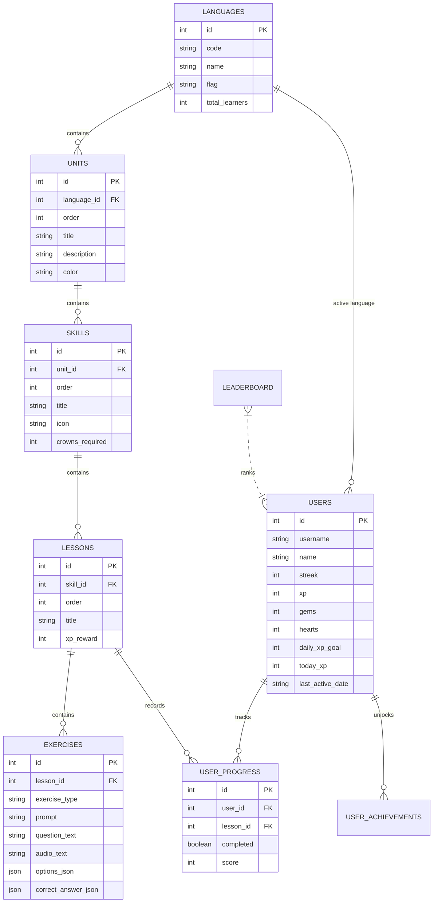

# Duolingo Web App - Fullstack Clone

A modern, high-fidelity clone of the **Duolingo Web Application** built according to the SDE Fullstack Assignment specifications. Recreates the playful gamified experience, authentic lesson loops, interactive exercise types, sound effects, mascot flourishes, and learner progress mechanics.

---

## 🌟 Live Demo & Architecture Highlights

- **Visual Fidelity**: Recreates Duolingo's signature rounded aesthetic, 3D beveled buttons, green brand palette (`#58cc02`), sound chimes, and responsive winding learning path.
- **5 Interactive Exercise Types**:
  1. `Multiple Choice`: Picture/card options with hotkey support (1, 2, 3)
  2. `Translate (Word Bank)`: Click-to-build word bank with interactive slots
  3. `Match Pairs`: Interactive matching tiles with sound and validation
  4. `Fill in the Blank`: Dynamic in-sentence blank slot completion
  5. `Type the Answer`: Free text input with Spanish accent helper buttons (`á, é, í, ó, ú, ñ`)
- **Gamification Engine**:
  - Streak tracking with simulated/testable day progression
  - XP accumulation, Daily Goals (10, 20, 30, 50 XP), and weekly Leaderboards (Silver League)
  - Hearts health system (5 max): deductions on incorrect answers, out-of-hearts handling, gem refills (350 gems), and free practice sessions
- **Audio & Accessibility**:
  - Built-in Web Audio API synthesizer for 0-latency signature chimes & buzzes
  - Integrated Spanish Speech Synthesis (Text-to-Speech) for instant authentic pronunciation
  - Dark Mode and Sound toggle

---

## 🏗️ Tech Stack

| Layer | Technology | Details |
| :--- | :--- | :--- |
| **Frontend** | Next.js 16 (App Router) & TypeScript | React 19, Tailwind CSS, Lucide Icons, Canvas-Confetti |
| **Backend** | Python 3.12 & FastAPI | Clean REST architecture, Pydantic validation, CORS middleware |
| **Database** | SQLite3 | Relational schema with foreign keys, constraints, and indexes |
| **Audio** | Web Audio API & Web Speech API | Dual synthesized chimes & native browser Spanish TTS |

---

## 📁 Repository Structure

```tree
Duolingo/
├── backend/
│   ├── database.py              # SQLite connection pool, row factory, & pragmas
│   ├── schema.sql               # Relational DDL schema with constraints & indexes
│   ├── models.py                # Database entity definitions
│   ├── schemas.py               # Pydantic request & response schemas
│   ├── seed.py                  # Database seeder (Spanish units, lessons, exercises, user)
│   ├── main.py                  # FastAPI application entrypoint & CORS
│   ├── requirements.txt         # Python dependencies
│   ├── routers/
│   │   ├── courses.py           # /api/courses/path (curved skill tree, crown states)
│   │   ├── lessons.py           # /api/lessons/{id}, submit-answer, complete
│   │   ├── users.py             # /api/users/me, hearts, streak simulator, daily goals
│   │   └── leaderboard.py       # /api/leaderboard (weekly Silver League standings)
│   └── tests/
│       └── test_api.py          # Comprehensive automated unit & integration tests
├── frontend/
│   ├── src/
│   │   ├── app/
│   │   │   ├── layout.tsx       # Root layout & page metadata
│   │   │   ├── globals.css      # Duolingo 3D button classes, theme variables, keyframes
│   │   │   └── page.tsx         # Main coordinator page
│   │   ├── components/
│   │   │   ├── DuoMascot.tsx    # Duo Owl vector with moods (happy, celebrating, shocked)
│   │   │   ├── TopBar.tsx       # Flag, streak flame, gems, hearts counter
│   │   │   ├── Sidebar.tsx      # Desktop navigation (Learn, Leaderboards, Quests, Shop, Profile)
│   │   │   ├── RightSidebar.tsx # Super promo, daily quests progress, leaderboard snapshot
│   │   │   ├── MobileNav.tsx    # Responsive bottom navigation bar
│   │   │   ├── PathTree.tsx     # Winding serpentine skill path & unit headers
│   │   │   ├── LessonPlayer.tsx # Fullscreen lesson player loop & state manager
│   │   │   ├── FeedbackBar.tsx  # Signature green/red bottom feedback bar
│   │   │   ├── LessonCompleteModal.tsx # Confetti celebration & stat recap
│   │   │   ├── OutOfHeartsModal.tsx    # Out of hearts handling & gem refill
│   │   │   ├── QuitLessonModal.tsx     # Session exit confirmation
│   │   │   ├── ProfileView.tsx  # Learner stats, achievements & streak simulator
│   │   │   ├── LeaderboardView.tsx     # Silver League standings & promotion zone
│   │   │   ├── QuestsView.tsx   # Daily & monthly quest tracker
│   │   │   ├── ShopView.tsx     # Heart refill, streak freeze, power-ups
│   │   │   ├── SettingsModal.tsx# Daily XP goal selector, theme & sound toggles
│   │   │   └── exercises/
│   │   │       ├── MultipleChoiceExercise.tsx
│   │   │       ├── TranslateExercise.tsx
│   │   │       ├── MatchPairsExercise.tsx
│   │   │       ├── FillInTheBlankExercise.tsx
│   │   │       └── TypeTheAnswerExercise.tsx
│   │   └── lib/
│   │       ├── api.ts           # Type-safe API client
│   │       └── sound.ts         # Web Audio synthesizer & Spanish TTS engine
│   ├── package.json
│   └── tsconfig.json
└── README.md
```

---

## 🗄️ Database Schema Design

The SQLite relational database (`backend/schema.sql`) implements referential integrity (`PRAGMA foreign_keys = ON;`) with cascade deletions and performance indices:



---

## 🚀 Setup & Execution Instructions

### 1. Backend Setup (FastAPI & SQLite)

From the project root:

```bash
# Navigate to backend
cd backend

# Install dependencies
pip install -r requirements.txt

# Run the database seeder (initializes SQLite DB with Spanish course content)
python seed.py

# Start the FastAPI server (runs on http://127.0.0.1:8000)
uvicorn main:app --reload --port 8000
```

> **Interactive API Docs**: View the Swagger UI documentation at `http://127.0.0.1:8000/docs`.

### 2. Frontend Setup (Next.js & TypeScript)

From the project root in a second terminal:

```bash
# Navigate to frontend
cd frontend

# Install dependencies
npm install

# Start development server
npm run dev
```

Visit **`http://localhost:3000`** in your browser.

---

## 🧪 Running Automated Tests

Run the backend unit and integration test suite:

```bash
python backend/tests/test_api.py
```

Tests cover:
- Course path hierarchy & unit/skill progress calculation
- All 5 exercise types submission and scoring
- Accent and case normalization for Spanish text
- Heart reduction on mistakes & failure state handling
- Streak increment and reset mechanics
- Gem deduction for heart refills and free practice mode

---

## 🎮 Gamification & Streak Testing

As requested in the assignment rubric:
> *"Streak counter that increments on daily activity (day logic can be simulated/testable)"*

Navigate to the **Profile** tab in the app to find the **Interactive Streak Simulator**:
- **Simulate Tomorrow (Next Day)**: Sets your last active date to yesterday. Completing your next lesson immediately increments your streak with animation!
- **Simulate Inactivity (Skip 3 Days)**: Sets your last active date to 3 days ago. Completing a lesson tests the streak reset condition.
- **Reset Streak**: Resets the streak counter to 1.
